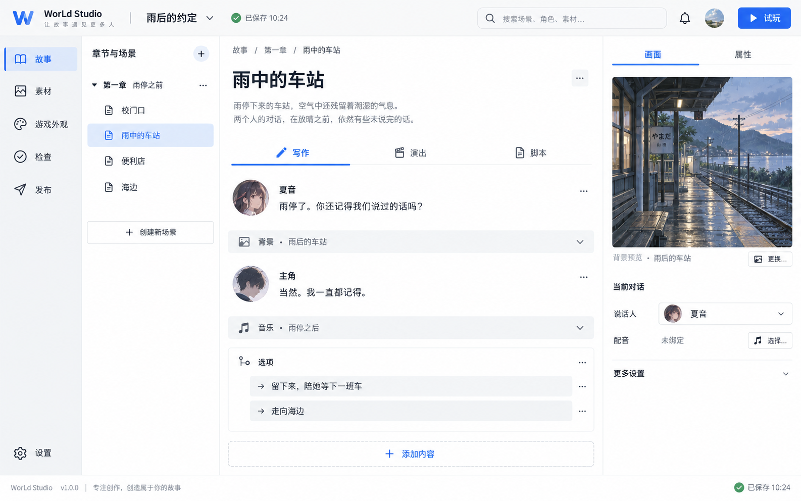
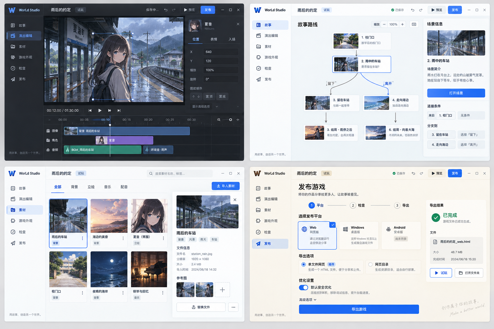
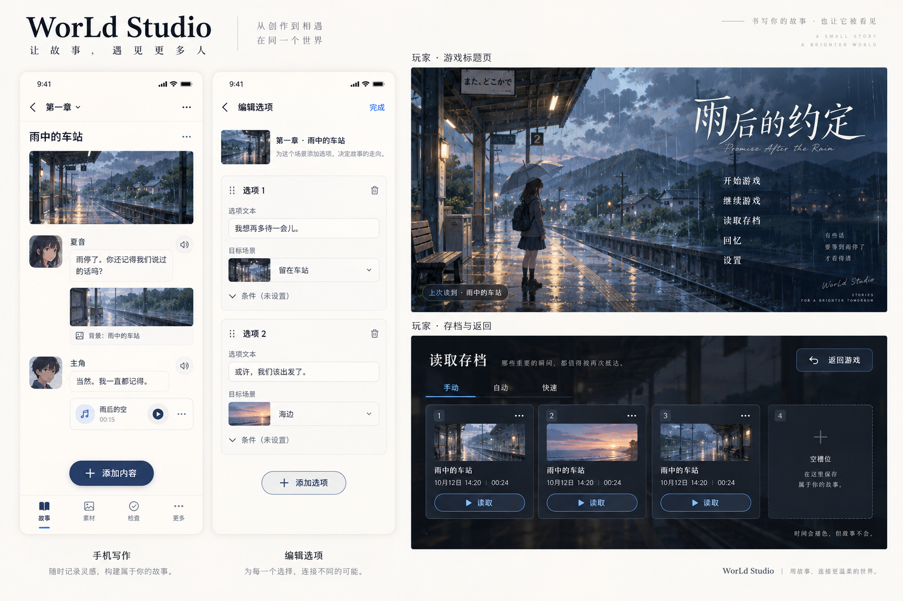

# WorLd Studio 全界面与交互重设计 · 2026-10-12

> 此目录保留前期概念图与示例数据原型。后续已按用户要求直接改造并检查真实软件，当前实现、实际截图和未解决问题见 [开发审计 #303](../../303-development-state-and-ui-audit.md)。下文是当时设计记录，不是最终实现状态或产品验收结论。

本轮是可以打开、点击和评审的产品设计方案。用户明确提出：现有界面令人迷惑、视觉不好、功能平铺，要求先出图，再设计完整系统。方案覆盖编辑器、导出游戏的玩家界面以及桌面、手机两种布局。业务运行、存档、编译器仍使用原有代码；设计原型使用示例数据，不执行真实导出或改写工程。

## 直接查看

- [可点击原型](prototype.html)：26 个页面入口，浅色 / 深色 / 暖纸 / 跟随系统，桌面 / 手机，6 种状态预览。
- [全部界面图](all-pages.html)：26 个页面的实际原型截图，点击看大图。
- [完整界面与交互规格](interaction-spec.md)：页面归属、二级页面、抽屉、弹窗、关键任务、异常恢复。
- [视觉系统与实现接续](visual-system-and-implementation.md)：主题、布局、组件、现有代码迁移、实施顺序与验收。
- [验证记录](verification.json)：在浏览器中实际运行后的结果。

## 第一轮视觉图

图像由内置 imagegen 生成；它们用于评审视觉气质与空间分配。图中个别生成文字、头像、通知、额外导航、示例版本、时间和发布结果不构成功能承诺。页面和行为以可点击原型与交互规格为准。正式产品不增加账号、头像或通知中心。

原型的背景插画也由内置 imagegen 生成，仅作为设计样例；角色框明确标记占位。原图保持完整，嵌入预览使用压缩副本。真实作品素材与舞台编辑语义需在实施阶段接入。

## 本轮主要设计决定

1. 主导航按任务组织为故事、素材、游戏外观、检查、发布。编辑器设置放在固定次要入口。
2. 场景只有写作、演出、脚本三个视图。角色、变量和路线是故事模块内的独立页面。
3. 写作正文占主要空间。预览和当前对象属性按需打开；发布、资源优化与技术报告全部移出写作页。
4. 同时只打开一个有焦点的弹层。复杂任务进入页面，对象属性使用抽屉，短操作使用对话框；层内再选择时替换内容并提供返回，不叠多个弹窗。
5. 手机采用单任务页面和全屏二级编辑，复用业务数据，不缩小桌面三列布局。
6. 主题属于编辑器个人偏好，游戏外观属于工程，两者分别管理。

## 生成提示词

本轮使用内置 imagegen，未使用 CLI/API 回退。四次最终提示分别为：

1. `ui-mockup`：中文 WorLd Studio 桌面写作台；浅色创作区，故事/素材/游戏外观/检查/发布导航，章节场景列表，写作/演出/脚本标签，大面积中文对白，折叠媒体提示，可选小预览与当前对象属性；移除发行与技术信息。
2. `ui-mockup`：2×2 工作区视觉板；深色演出、浅色故事路线、浅色素材库与属性抽屉、暖纸发布步骤；共用排版与层级；Android 标明尚未开放。
3. `ui-mockup`：手机写作与全屏选项编辑、玩家标题与存档返回；手机单列、大触摸目标；玩家菜单和存档不暴露技术 ID，未解锁内容不剧透。
4. `illustration-story`：雨后蓝调时刻的乡间海边车站，湿站台、暖色灯光、山与海；横屏动漫场景；无文字、无人物、无界面；为设计样例留出内容空间。

## 维护

`prototype-source.html` 是交互源文件。`build-preview.mjs` 嵌入预览图并生成可独立打开的 `prototype.html` 和会话内预览片段。它使用当前机器的 bundled runtime 路径；换机器时修改依赖路径即可，生成后的原型不需要 Node 或网络。

此目录是设计提案，不将“设计完成”记为 M1 实现或产品验收完成。下一步按规格先实施项目壳与创作闭环，再迁移独立工具页。
